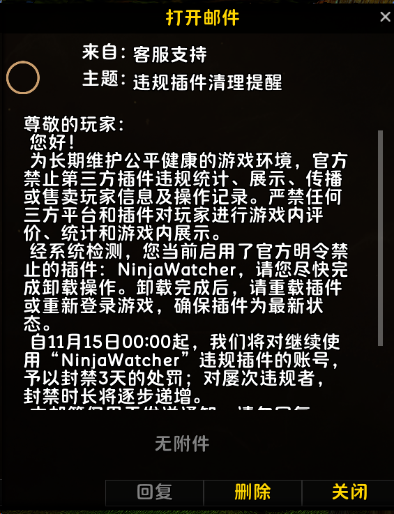
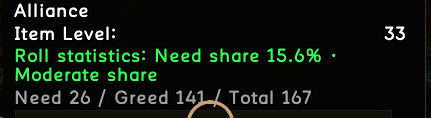
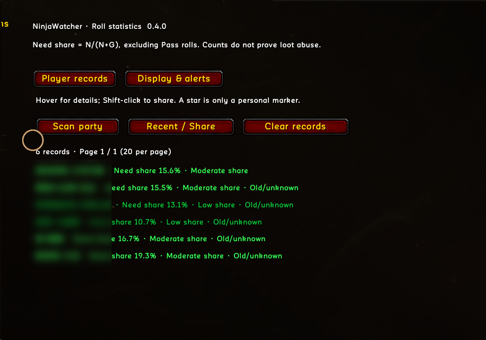
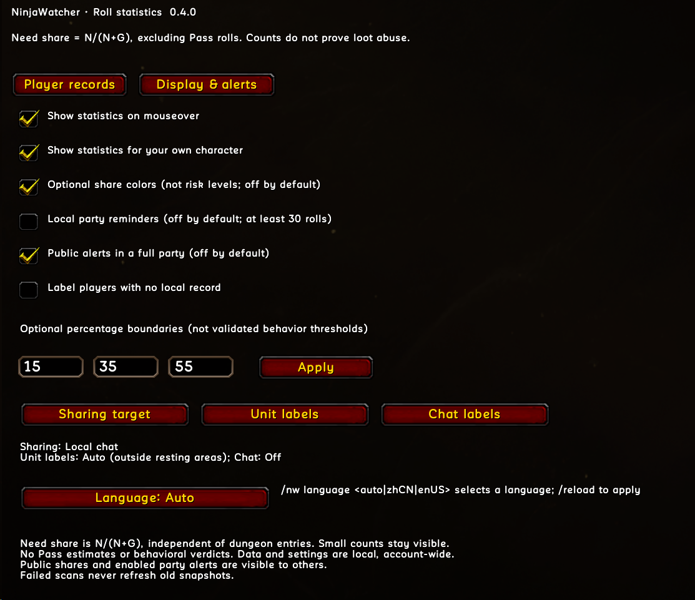

# RollLedger

**English** | [简体中文](README.zh-CN.md)

A World of Warcraft addon that displays cumulative Need/Greed roll statistics, with local player records, optional party alerts, and manual sharing.

> **Available in English and Simplified Chinese (since v0.4.0).** The interface and messages follow your client language by default: Simplified Chinese on `zhCN`, English on other clients. Use `/rledger language enUS` or `/rledger language zhCN`, then `/reload`, to override the language. More languages are planned.

> **Statistics provide context—not proof of loot abuse.** A high Need share does not establish malicious behavior, and a low share does not establish fair play.

## Important warning: account suspension risk on Chinese servers

**Players on Chinese servers should stop using and uninstall this addon. Renaming it does not constitute permission and does not guarantee protection from detection or account suspension.**

The user-provided in-game customer-support notice below explicitly names `NinjaWatcher` as a prohibited addon. It states that, starting at **00:00 on November 15**, accounts that continue using it will receive a **three-day suspension**, with progressively longer suspensions for repeated violations. The screenshot does not show a year; consult the operator's latest announcements and support notices.

The notice also prohibits third-party addons from improperly collecting, displaying, distributing, or selling player information and activity records, and from rating, compiling statistics about, or displaying assessments of players in-game. The restriction is not merely about the addon name: renaming it, keeping output local, or disabling sharing does not establish compliance.

- **Chinese servers:** The warning above establishes a risk of account suspension. Installation or continued use is not recommended.
- **Blizzard-operated servers:** According to the user's report, there are currently no restrictions specifically targeting this addon. This is not official authorization or a safety guarantee; regional rules and client compatibility must still be checked separately.
- **Detection method:** The user reports that detection involves the addon name, but we cannot independently confirm that detection relies on names alone. No rename is promised to bypass detection.



## Features

- **Compact mouseover tooltip:** See a player’s Need share and cumulative Need / Greed / total counts in two lines.
- **Local player records:** Browse previously scanned players, sort by last scan or Need share, and view collection times and scan status.
- **Optional unit-frame labels:** Display locally recorded statistics beside target, focus, and party frames.
- **Optional chat-name labels:** Recognize previously recorded players without changing the original clickable player link.
- **Manual sharing:** Print statistics locally, prepare text in the chat input, or explicitly share them with a party, raid, guild, or whisper recipient.
- **Optional numerical alerts:** Enable local or party alerts if desired. Automatic alerts are off by default.
- **Personal markers:** Keep local reference marks without changing a player’s statistics or reporting anyone to an external service.

## Screenshots

The screenshots below show the English interface before the RollLedger rename; they may still display the former NinjaWatcher name. Colors, share-band descriptions, and alert settings reflect the configuration used for these screenshots, not necessarily the defaults.

### Mouseover tooltip



### Player records



### Display & alerts



## Compatibility

Designed for **WoW Forever 1.60.1 / Interface `16001` / game type `camelot`**.

Support for other Retail or Classic clients is not currently guaranteed. Both English and Simplified Chinese are included; other client languages use English as the fallback.

## Installation

1. Download the repository as a ZIP and extract it.
2. Copy **only the `RollLedger` folder** into your client’s `Interface/AddOns/` directory:

   ```text
   Interface/
   └── AddOns/
       └── RollLedger/
           ├── RollLedger.toc
           ├── Core.lua
           └── ...
   ```

   Do not install the entire extracted repository as the addon folder.
3. Remove or move aside the old `NinjaWatcher` addon folder and other copies of RollLedger to avoid loading both versions. Keep saved-data backups separately.
4. Restart the game and enable RollLedger in the addon list.
5. Type `/rledger` to open the player catalog and settings.

**Upgrading RollLedger?** Exit the game and back up `RollLedger.lua` and its `.bak` under `WTF` before replacing the addon. Supported older database schemas are migrated when loaded.

### Manual migration from NinjaWatcher

RollLedger uses a new addon identity and `RollLedgerDB` saved variable. It does **not** automatically load the old addon or read `NinjaWatcherDB`. Migration is optional; without it, RollLedger starts with empty records and default settings. These instructions do not make use on Chinese servers permitted or safe.

1. Fully exit the game (not just `/reload`) and back up the entire `WTF` directory.
2. In `WTF/Account/<account>/SavedVariables/`, copy `NinjaWatcher.lua` to `RollLedger.lua`. If `RollLedger.lua` already exists, back it up before overwriting it; databases are not merged.
3. Open the copied `RollLedger.lua` in a UTF-8 text editor. Change **only the top-level assignment** `NinjaWatcherDB = {` to `RollLedgerDB = {`. Leave the contents of the table unchanged. Do not copy the old `.bak` over the new file.
4. Remove or move aside `Interface/AddOns/NinjaWatcher/`, install `Interface/AddOns/RollLedger/`, and enable only RollLedger. Retain the original saved files in your backup.
5. Log in only where use is permitted, then check records, settings, and language with `/rledger`. If migration fails, exit the game before restoring your backup; do not delete the original data.

## Using the addon

Hover over a player to request their statistics. The tooltip shows only the summary and roll counts. The English display looks like this:

```text
Roll statistics: Need share 15.6%
Need 26 / Greed 141 / Total 167
```

The first line is the **Need share**. The second lists **Need / Greed / total** counts. Under `/rledger` → **Display & alerts**, disable **Show share-band text in tooltips** to hide descriptions such as “Moderate share” (on by default; no reload required). The percentage, title, counts, and existing colors stay unchanged. Other views and shared messages are unaffected. Band descriptions appear only when global share bands are enabled.

More details, including collection time, dungeon entries, and scan failures, are available in the `/rledger` player catalog.

You can also scan your current party with `/rledger scan`, or inspect your own statistics with `/rledger status`. Scans depend on the client’s public-statistics API and can be unavailable because of distance, combat restrictions, or hidden data.

### Sharing

Sharing defaults to **local output**, visible only to you. Use `/rledger share party` to explicitly send statistics to your party, or open the quick-button panel with `/rledger broadcast`.

Shift-clicking a catalog row uses your selected sharing destination. Sending through a saved public destination requires confirmation; explicitly labeled Party/Raid buttons send immediately. Shared messages include a neutral caveat and snapshot freshness information.

### Defaults

- Numerical tooltip display: **on**.
- Optional color bands: **off**.
- Automatic local and public party alerts: **off**.
- Chat-name labels: **off**.
- Unit-frame labels: automatic mode, normally shown in instances and outdoors and hidden in resting areas.

## Commands

Use `/rledger` or `/rollledger`; both accept the same subcommands. The addon does not register `/rl`, leaving the commonly used reload shortcut available.

Command keywords stay the same in both languages. Interface labels, help, reminders, and shared messages use the selected language.

| Command | Purpose |
| --- | --- |
| `/rledger` | Open records and settings |
| `/rledger scan` | Scan the current party |
| `/rledger status` | Show your own statistics |
| `/rledger language auto` / `zhCN` / `enUS` | Choose a language, then `/reload` to apply it |
| `/rledger share` | Share the hovered or targeted player’s statistics locally by default |
| `/rledger share party` | Send statistics to the party |
| `/rledger share whisper Player-Realm` | Share by whisper |
| `/rledger target self` | Set the default sharing destination: `self`, `edit`, `say`, `party`, `raid`, `guild`, or `whisper` |
| `/rledger broadcast` | Open the statistics-sharing panel |
| `/rledger icon minimap` / `float` / `hide` | Choose the quick-button mode |
| `/rledger badge auto` / `on` / `off` | Choose unit-frame label mode |
| `/rledger tag off` / `whisper` / `all` | Choose chat-name label mode |
| `/rledger bands on` / `/rledger bands off` | Enable / disable optional share colors |
| `/rledger tier 15 35 55` | Customize descriptive percentage boundaries |
| `/rledger rule` / `/rledger rule reset` | Show / reset the boundaries |
| `/rledger clear` | Show the confirmation command for deleting local records |

## Understanding the statistics

RollLedger reads cumulative **Need** and **Greed** counters exposed by the client:

```text
Total recorded rolls = Need + Greed
Need share = Need / (Need + Greed)
```

- Missing or unreadable values are not treated as zero.
- No recorded rolls means there is no percentage to calculate—not a 0% Need share.
- Small recorded counts remain visible with a small-count note.
- Dungeon-entry counts are optional context. They never reduce or exempt a player’s Need share.
- Optional percentage colors describe numerical ranges, not a validated risk score.
- The addon does not estimate Pass counts or determine whether a particular Need roll was justified.

These lifetime counters do not reveal which items were rolled on, whether an item was an upgrade, or what loot rules the group agreed to. They should not be used as a verdict about another player.

Old records can be browsed and shared, but may be out of date. The player catalog shows collection times and failed attempts; the compact mouseover tooltip intentionally omits these details.

## Privacy and saved data

Records and settings are stored **locally and account-wide** in `RollLedgerDB`.

- No automatic website uploads or shared blacklist synchronization.
- Ordinary chat messages are sent only through manual sharing or explicitly enabled automatic party alerts.
- Personal markers are local notes, not reports to Blizzard or another service.
- Scan failures do not refresh the timestamp of a previous successful record.

When upgrading from earlier versions, ambiguous old zero values may appear as unavailable until rescanned. Previous automatic alerts, color bands, and chat labels are disabled during migration.

**`/rledger clear confirm` permanently deletes local player records, personal markers, recent scan attempts, and the migration backup.** Settings are retained. Back up your SavedVariables if you want to keep the records.

## Language support

| Language | Status |
| --- | --- |
| Simplified Chinese (`zhCN`) | Available |
| English (`enUS`) | Available; also the fallback for other client languages |
| Additional languages | Planned |

Language preference is saved account-wide. The default is `auto`: a `zhCN` client uses Simplified Chinese, while `enUS`, `enGB`, and unsupported client languages use English.

```text
/rledger language enUS   — English
/rledger language zhCN   — Simplified Chinese
/rledger language auto   — Follow the client
/reload            — Apply the saved choice
```

You can also cycle the language button under Display & alerts. Changes apply after `/reload` so existing windows and newly displayed messages do not mix languages. Player records are not changed by switching languages. Shared messages use your selected addon language, not the recipient’s client language.

## Acknowledgements

Thank you to the original author, subsequent community maintainers, and NGA users who contributed ideas, fixes, and feedback. This maintained version builds on their work:

- **Original NinjaWatcher release:** [NGA thread — 47784247](https://bbs.nga.cn/read.php?tid=47784247).
- **Subsequent modified version:** [NGA thread — 47910654](https://bbs.nga.cn/read.php?tid=47910654).

This maintained version is now called RollLedger; its upstream addon was named NinjaWatcher. The rename is not an endorsement by upstream authors, operator approval, or a guarantee against detection or account suspension. Old saved data requires the manual migration described above. See [AUTHORS.md](AUTHORS.md) for provenance and the current licensing status, and [CHANGELOG.md](CHANGELOG.md) for changes.

## Licensing status

No explicit license was found in the supplied upstream packages. Upstream permissions and a compatible project license still need to be confirmed. Attribution and public availability do not replace permission to redistribute or relicense inherited code. See [AUTHORS.md](AUTHORS.md).
