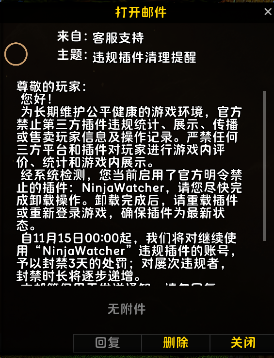
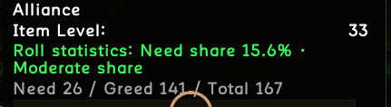
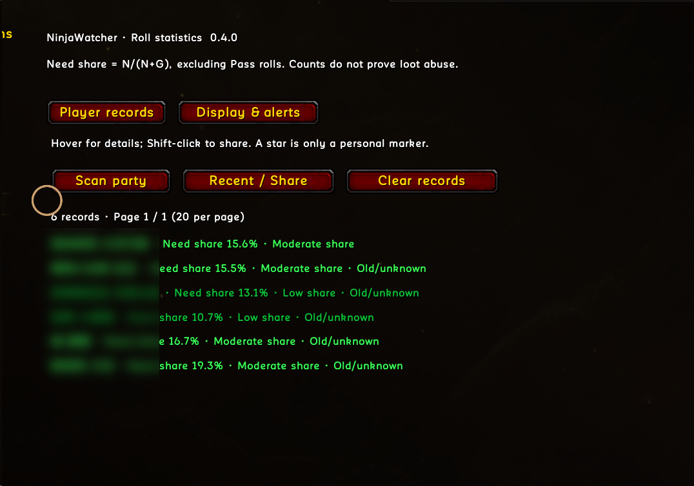
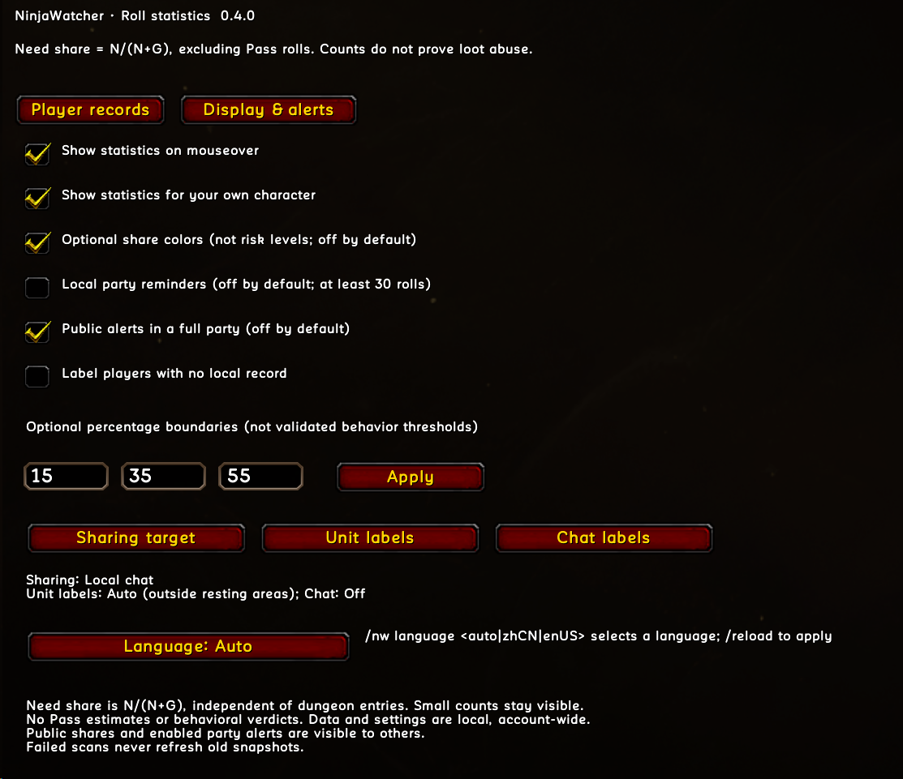

# RollLedger

[English](README.md) | **简体中文**

RollLedger 魔兽世界插件独立维护版：展示需求／贪婪掷骰累计统计与需求占比，支持本地玩家记录、可选队伍提醒及手动分享。

> **v0.4.0 已支持简体中文和英文。** 默认跟随客户端：简体中文客户端显示中文，其他客户端回退英文。可输入 `/rledger language zhCN` 或 `/rledger language enUS`，再 `/reload` 手动切换；未来计划支持更多语言。

> **统计用于提供参考，不是恶意抢装备的证据。** 高需求占比不等于恶意需求，低需求占比也不能证明行为合理。

## 重要警告：中国服务器封号风险

**中国服务器用户请停止使用并卸载本插件；更名不代表获得许可，也不保证避免检测或封号。**

用户提供的游戏内客服邮件截图（见下方）明确点名 `NinjaWatcher` 为禁止使用的插件，并称自 **11 月 15 日 00:00 起**，继续使用的账号将被**封禁 3 天**，屡次违规的封禁时长将逐步递增。截图未显示年份，请以运营商最新公告和客服通知为准。

邮件同时禁止第三方插件违规统计、展示、传播或售卖玩家信息及操作记录，以及对玩家进行游戏内评价、统计和展示。限制并不只是插件名称：即使更名、仅本地显示或关闭分享，也不能据此认定合规。

- **中国服务器：** 已有上述警告与封号风险，不建议安装或继续使用。
- **暴雪自营服务器：** 据用户反馈，目前没有针对本插件的专门限制；这并非官方授权或安全保证，不同地区、客户端的规则与兼容性仍需单独确认。
- **检测方式：** 用户反馈认为检测涉及插件名称，但目前无法独立确认检测是否仅依赖名称。本文不承诺任何更名能够规避检测。



## 功能

- **精简悬停提示：** 两行显示需求占比，以及需求／贪婪／合计次数。
- **本地玩家记录：** 浏览已扫描玩家，按最近扫描或需求占比排序，查看采集时间与扫描状态。
- **可选框体标签：** 在目标、焦点及小队框体旁显示已有记录的统计。
- **可选聊天标签：** 为聊天名字添加本地统计，不改变原有玩家链接与点击密语功能。
- **手动分享：** 输出到本地、填入聊天输入框，或明确分享到小队、团队、公会及密语等频道。
- **可选数值提醒：** 按需开启本地或小队提醒，自动提醒默认关闭。
- **个人标记：** 仅供本地参考，不改变玩家统计，不向外部服务举报。

## 界面截图

以下为更名为 RollLedger 前的英文界面截图，可能仍显示原 NinjaWatcher 名称。截图中的颜色、占比分档描述与提醒开关仅代表截图时的配置，不一定是默认设置。

### 鼠标悬停提示



### 玩家记录



### 显示与提醒



## 客户端兼容性

适配目标为 **WoW Forever 1.60.1 / Interface `16001` / 游戏类型 `camelot`**。

暂不保证兼容其他正式服、经典旧世或其他客户端。游戏内界面与消息已包含简体中文和英文，未支持的客户端语言默认使用英文。

## 安装

1. 下载仓库 ZIP 并解压。
2. 将其中的 **`RollLedger` 文件夹**复制到客户端 `Interface/AddOns/`：

   ```text
   Interface/
   └── AddOns/
       └── RollLedger/
           ├── RollLedger.toc
           ├── Core.lua
           └── ...
   ```

   **不要把整个解压后的仓库文件夹当作插件安装。**
3. 删除或移走旧 `NinjaWatcher` 插件目录及其他 RollLedger 副本，避免同时加载；存档备份请另行保留。
4. 重启游戏，在插件列表中启用 RollLedger。
5. 输入 `/rledger` 打开玩家记录和设置。

**升级 RollLedger 前：** 请退出游戏，备份 `WTF` 中的 `RollLedger.lua` SavedVariables 文件及其 `.bak`，然后替换插件。加载时会迁移支持的旧版数据库结构。

### 从 NinjaWatcher 手动迁移

RollLedger 使用新的插件标识和存档字段 `RollLedgerDB`，**不会自动加载旧插件，也不会读取 `NinjaWatcherDB`**。迁移为可选操作；不迁移时使用空记录和默认设置。以下操作不代表在中国服务器使用已获许可或安全。

1. 完全退出游戏（不仅是 `/reload`），备份整个 `WTF` 目录。
2. 在 `WTF/Account/<账号>/SavedVariables/` 下，将 `NinjaWatcher.lua` **复制**为 `RollLedger.lua`。若新文件已经存在，覆盖前先另行备份；此操作不会合并两份数据库。
3. 用 UTF-8 文本编辑器打开复制出的 `RollLedger.lua`，**只将顶层赋值** `NinjaWatcherDB = {` 改为 `RollLedgerDB = {`，表内数据保持不变。不要用旧 `.bak` 覆盖新文件。
4. 删除或移走 `Interface/AddOns/NinjaWatcher/`，安装 `Interface/AddOns/RollLedger/`，仅启用 RollLedger。原始存档请继续保留在备份中。
5. 仅在允许运行的服务器登录，通过 `/rledger` 核对玩家记录、设置和语言。如迁移失败，先退出游戏再恢复备份，不要删除原始数据。

## 使用方法

将鼠标移到玩家身上，即可请求其公开统计。提示框只显示两行，例如：

```text
掷骰统计参考：需求占比 15.6%
需求 26 / 贪婪 141 / 合计 167
```

在 `/rledger` →“显示与提醒”中，可通过“鼠标提示中显示占比分档描述”开关控制“占比中等”等文字（默认开启，无需重载）。关闭后仍显示标题、需求占比百分比及需求／贪婪／合计，原有颜色不变；目录、分享和其他标签也不受影响。分档文字仅在启用全局占比分档时显示。

进本次数、采集时间和扫描失败等详细信息可在 `/rledger` 玩家目录中查看，不放入精简悬停提示。

也可以使用 `/rledger scan` 扫描当前小队，或使用 `/rledger status` 查看自己的统计。扫描依赖客户端公开统计接口，可能因距离、战斗限制或数据隐藏而暂时不可用。

### 分享统计

默认分享目标为**本地聊天框，仅自己可见**。使用 `/rledger share party` 明确发送到小队，或通过 `/rledger broadcast` 打开快捷分享面板。

Shift+点击玩家目录中的一行，会使用当前分享目标。通过已保存的公开目标发送需要二次确认；面板中明确标注的“小队／团队”按钮会立即发送。公开消息保留中性说明与快照时效信息。

### 默认设置

- 悬停数值显示：**开启**。
- 可选占比颜色：**关闭**。
- 自动本地提醒与自动公开小队提醒：**关闭**。
- 聊天名字标签：**关闭**。
- 框体标签：自动模式，通常在副本和野外显示，在休息区隐藏。

## 常用命令

使用 `/rledger` 或 `/rollledger`，两者支持相同的子命令。插件不注册 `/rl`，避免占用玩家常用的重载快捷命令。

| 命令 | 用途 |
| --- | --- |
| `/rledger` | 打开玩家记录与设置 |
| `/rledger scan` | 扫描当前小队 |
| `/rledger status` | 查看自己的统计 |
| `/rledger language auto` / `zhCN` / `enUS` | 选择语言，输入 `/reload` 后生效 |
| `/rledger share` | 分享当前悬停或目标玩家的统计，默认仅输出本地 |
| `/rledger share party` | 发送到小队 |
| `/rledger share whisper 玩家名-服务器` | 密语分享 |
| `/rledger target self` | 设置默认分享目标，可选 self/edit/say/party/raid/guild/whisper |
| `/rledger broadcast` | 打开统计分享面板 |
| `/rledger icon minimap` / `float` / `hide` | 小地图／悬浮／隐藏快捷图标 |
| `/rledger badge auto` / `on` / `off` | 框体标签模式 |
| `/rledger tag off` / `whisper` / `all` | 聊天名字标签模式 |
| `/rledger bands on` / `/rledger bands off` | 开关可选占比颜色 |
| `/rledger tier 15 35 55` | 自定义百分比分档界值 |
| `/rledger rule` / `/rledger rule reset` | 查看／恢复默认界值 |
| `/rledger clear` | 查看清除本地记录的确认命令 |

## 如何理解统计

插件读取客户端提供的需求与贪婪累计次数：

```text
已记录掷骰总数 = 需求次数 + 贪婪次数
需求占比 = 需求次数 / 已记录掷骰总数
```

- 缺失或不可读的数据不会当作0。
- 没有已记录掷骰意味着无法计算占比，不是0%需求。
- 累计计数较少时仍显示真实占比，并附计数较少提示。
- 进本次数仅为辅助信息，不降低占比，也不作为免责条件。
- 可选颜色只描述数值区间，不是经过验证的风险等级。
- 不估算放弃次数，不判断某次需求是否合理。

累计统计不能说明玩家需求了哪件装备、装备是否提升或队伍约定是什么，不应当作为对其他玩家的定论。

历史记录可以查看和分享，但可能过期。玩家目录展示采集时间和失败状态；精简悬停提示不显示这些详情。

## 隐私与数据

记录与设置保存在账号级本地 `RollLedgerDB` 中。

- 不自动上传网站，不同步共享黑名单。
- 只有手动分享或明确开启的自动队伍提醒会发送普通聊天消息。
- 个人标记不是向暴雪、网站或其他服务举报。
- 扫描失败不会刷新已有成功记录的采集时间。

从旧版升级时，部分原先含糊记为0的数据可能变成“不可读”，重新扫描后更新。迁移时会关闭旧版自动提醒、颜色分档和聊天标签。

**`/rledger clear confirm` 会永久删除本地玩家记录、个人标记、最近扫描尝试和迁移备份，不重置设置。** 如需保留记录，请先备份SavedVariables。

## 多语言支持

| 语言 | 状态 |
| --- | --- |
| 简体中文（`zhCN`） | 已支持 |
| 英文（`enUS`） | 已支持，也是其他客户端语言的回退语言 |
| 更多语言 | 计划中 |

语言选择按账号保存，默认 `auto`：简体中文客户端使用中文，`enUS`、`enGB` 和其他暂未支持的客户端语言使用英文。

```text
/rledger language zhCN   — 简体中文
/rledger language enUS   — 英文
/rledger language auto   — 跟随客户端
/reload            — 应用已保存的选择
```

也可以在“显示与提醒”中点击语言按钮循环选择。语言在 `/reload` 后统一生效，避免已有窗口与新消息混用语言；切换语言不改变玩家记录。公开分享使用你选定的插件语言，不会根据收件人的客户端语言自动翻译。

## 致谢

感谢原作者、后续修改维护者及NGA社区玩家提供的思路、代码、修复和反馈。本维护版建立在他们的工作基础之上：

- **最原始版本：** [NGA原帖 — 47784247](https://bbs.nga.cn/read.php?tid=47784247)。
- **二次修改版本：** [NGA修改版帖 — 47910654](https://bbs.nga.cn/read.php?tid=47910654)。

本维护版现更名为 RollLedger，上游插件原名为 NinjaWatcher。更名不表示得到上游作者背书或运营商许可，也不保证避免检测或封号。旧存档需要按上文说明手动迁移。来源及授权状态见 [AUTHORS.md](AUTHORS.md)，更新内容见 [CHANGELOG.md](CHANGELOG.md)。

## 授权状态

提供的上游包中未找到明确许可证，上游授权与兼容的项目许可证仍需确认。署名、致谢和公开可下载，不等于获得再分发或再许可授权，详情见 [AUTHORS.md](AUTHORS.md)。
